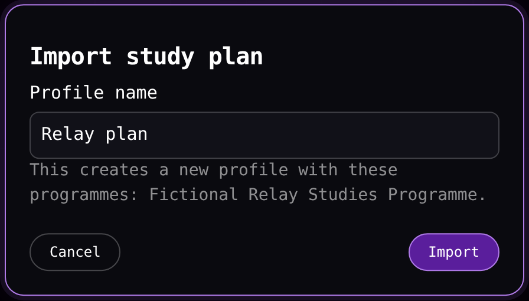

# Importing a study plan

A study plan from Sisu or Peppi imports into course-explorer as one profile, and the import names every module that waits and every item it leaves out.

## The study-plan formats a site offers

The formats of one platform are available to a site: the Sisu saved page, the Sisu plan PDF and the Sisu capture on a Sisu site, and the Peppi saved page and the Peppi capture on a Peppi site.

The drop note of the **Import** area names the formats the site offers, and the **?** drawer beside the area explains each of them. [Importing a Sisu plan](/docs/guides/sisu-import.md) gives the Sisu save, print and capture steps, and [Importing a Peppi plan](/docs/guides/peppi-import.md) gives the Peppi save and capture steps.

## The import dialog

The **Import** area takes a study-plan file and opens the dialog **Import study plan**. The area sits in the profile panel, and the same area sits below **Add programme** while **Structure of studies** holds no programme. [Profiles and language](/docs/guides/profiles-and-language.md#importing-a-file) describes the area and the other files it takes.

The dialog names the plan's programmes in order, lists every module that waits for a version choice, and names every item it left out with the reason. An item that matches several official items also lists their candidates.

Type a name for the profile in **Profile name**. **Import** is available once the name holds something. A name that a saved profile already holds makes the action **Overwrite**, states that the import replaces that profile's saved data, and shows the red notice **A profile with that name already exists**. The import creates or replaces the profile and opens it, and **Structure of studies** shows the imported plan. **Cancel**, Escape and a click outside the dialog leave the profiles as they are.

## The read in this browser

The file is read in this browser and is not uploaded. The import reads the official catalogue and the official structures from this site, and the saved page and the capture are read as they are, so the import makes no request to Sisu, to Peppi or to another site. The file's text is not stored, and no profile is written before **Import**.

## What the import places

The captured degrees become the top-level programmes of the tab in the order the plan shows them. The education that holds them is a container and never a programme of its own. Every captured module and course choice is placed inside its programme, its modules and its choices, and a course that the plan shows as completed is marked completed in the app as well.

The import matches the plan's items against the official catalogue this site serves. A course is matched by its exact official code, and a module by its exact code and then its exact official name among the official modules of the module that holds it. The nesting of the expanded page gives their order and shows which module holds each one.

A module that your plan selected outside the programme's official content becomes an added module inside the module or programme that held it, with its own official content, so a free-choice module of your plan holds its place.

## What the import names

Every item the import leaves unplaced is named to you. The dialog names the items it leaves out before you confirm, and a notice at the top of the **Structure of studies** tab content, above the tree, reads **The import skipped some items** and names what the placement left out. The notice is visible until you close it.

| Outcome | What it means |
|---|---|
| Named and left out | The item has no official match, or its identity is unresolved, so it is left out. A course the catalogue does not hold is left out together with its completion. |
| Named, left out, and its official candidates listed | The item matches several official items. The dialog names each candidate's code, name and group identity so you can tell same-name items apart. |
| Named as waiting for a version choice | The module's captured parent has several eligible versions or waits for a version choice, so the module cannot be matched until you choose that version. |
| Named, left out, and the courses it holds kept under **Unplaced studies** | The module is unresolved, its parent provides no readable official scope, or the catalogue holds no official structure for it, so the module is left out and the courses inside it that the catalogue holds are placed under **Unplaced studies** with their completions. |

A course or module that the parent's official rule names in two places stops the placement, and the tab reports **The plan choice is ambiguous**. The import chooses neither place.

## Waiting modules

The import records the module version the file names when that version belongs to the module, and otherwise the module's one eligible version. A module whose file names no version and that has several eligible versions is left without a version, and **Structure of studies** shows its **Choose module version** prompt. No year is inferred from the file.

After you choose the version, the waiting module is matched by its exact official code and then by its exact official name. A module with no unique match is named as left out, and the import never chooses one of the candidates.

## A paused plan

A profile file or a saved-data file can hold a waiting plan together with saved choices or places. The tab leaves such a plan unplaced and shows the notice **The plan import paused to preserve saved edits. Your profile is unchanged.** above the structure. The imported profile holds its saved structure and its waiting plan as the file supplied them.

A plan imported into a new profile starts with no saved choices or places, so its choices are placed on the first **Structure of studies** read.
