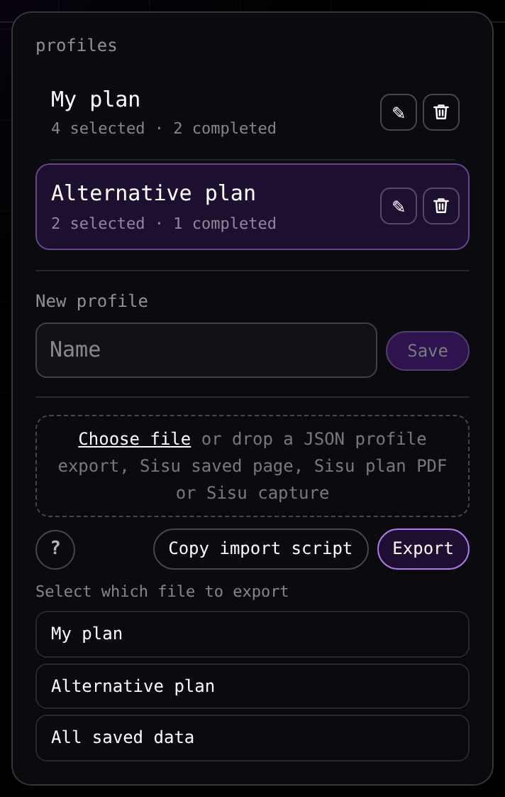

# Profiles and language

A profile is one named set of the app state, and the profile control and the language control manage the profiles of this browser.

## What a profile holds

A profile holds the language, the [shared course sets](/docs/guides/README.md#shared-course-state), and the state of each tab. The open tab belongs to the browser tab instead, so a profile never moves the tab you are looking at.

| Part | What the profile holds |
|---|---|
| App language | Finnish or English. |
| Selected courses | Every course in the selection. |
| Completed courses | Every course marked completed. |
| Search | The query and the **Active only** setting. |
| Compare | The two comparison slots. |
| Prerequisites | The open course, the search field, the **Recommended**, **Inferred** and **Active only** settings, the [route basis](/docs/guides/prerequisites.md#graph-options), the excluded courses, and the completed and excluded marks on module and requirement nodes. |
| Discover | The chosen list, the mode, the basis, and the **Active only** setting. |
| Structure of studies | The ordered [programmes](/docs/guides/structure-of-studies.md#adding-a-programme), the choices, the places of the courses and modules, the order of the course cards, and a study plan that the tab has not placed. |

A browser with no saved state starts with one profile named My plan. Each profile holds its own copy, so the courses and the settings of one profile do not appear in another.

A site that serves fewer tabs and features hides their controls. The saved **Compare** slots, the saved **Inferred** setting and the saved **Discover** list are values of the profile, so a site that serves the feature again finds them there. The open tab is not one of them: it belongs to the browser tab, so another tab keeps its own and a reload of one tab restores it. A profile saves the same values on every site.

The profiles belong to this browser. They are held in the local storage of the browser, so another browser or another device does not have them.

## The profile control

On desktop the control in the top bar carries the name of the open profile, and on a phone it is the first row of the **More** sheet at the bottom of the window. On a phone the profile rows and controls are large enough to tap, and a profile name wraps in full. Opening **My plan** hides the language, **GitHub**, **Feedback** and **Docs** row and footer and grows the sheet upward with the profile panel, leaving no empty space below it. Select it to open **Profiles**, which lists every profile of this browser. The panel holds the profile list, the **New profile** form, the **Import** area, and a bottom row with a **?** help control, **Copy import script** when the site configures a script, and **Export**. [Using the app on a phone](/docs/guides/phone.md) describes the **More** sheet that holds the control.

Every tab of the same browser opens the same saved state, so a change made in one open tab appears in the other open tabs, and a profile switch reaches them as well.

Each row shows the profile name and its counts, written as selected first and completed second, such as "4 selected · 2 completed". The open profile is marked.

## Creating a profile

1. Under **New profile**, type a name in the field that reads **Name**.
2. Select **Save**.

The profile that is created becomes the open one and starts as a copy of the profile that was open, so its courses and its settings carry over. **Save** is available once the field holds a name.

> [!TIP]
> A second profile starts as a copy of the open one and then changes on its own, so two profiles can hold two different plans of the same degree.

## Switching, renaming and deleting

Select a profile row to switch to that profile. The app opens it with its own language, courses and settings, and the tab you are looking at stays where it is.

The pencil control on a row renames that profile, and it is labelled with the profile name. The **Rename profile** dialog opens a field that carries the name. Change the name and select **Save**.

The trash control on a row deletes that profile, and it is labelled with the profile name. The confirmation reads **Delete profile “My plan”?**, with the name of the profile in place of My plan, and it offers **Cancel** and **Delete**. Deleting the profile that is open makes the first of the profiles left in the list the open one, and the confirmation states this. The delete control appears on each row only while two or more profiles are stored.

> [!WARNING]
> A deleted profile and everything that it holds leave this browser together. The courses and the settings of another profile are not affected.

## Profile names

The name of a profile is trimmed of the spaces around it before it is stored.

An empty name is refused, and the message is **Profile name cannot be empty**. The **Save** button of the profile form is not available while the field is empty.

A name that another profile already holds is refused, and the message is **A profile with that name already exists**. The names are compared as written, so two names that differ only in capitalisation are two different names. Creating or renaming a profile shows the message in a red box that grows into its place and shrinks away again, and it closes on its own after five seconds. With reduced motion set in the operating system the box appears and disappears at once.

## Exporting a profile or the saved data

1. Select the profile control to open **Profiles**.
2. Select **Export**. A list opens under the bottom row of the panel.
3. Select a profile to download it as one file, or select **All saved data** to download every profile with every setting of this browser.

Exporting a profile leaves the profiles as they are, and it does not open the exported profile. The list is open for several downloads in a row.

The **?** control at the left of the bottom row opens a drawer that explains profiles and export, the import area, each study-plan format the site configures, and the configured import script.

A profile downloads as `course-explorer-profile-<profile name>.json`. Every character that a file name cannot hold becomes `_`, and the spaces, the letters outside the plain Latin alphabet and the other characters of the name are kept. The whole saved data downloads as `course-explorer-saved-data.json`.

## Importing a file

1. Select the profile control to open **Profiles**.
2. Select **Choose file** in the **Import** area and pick one file, or drop one file onto the area.

The control reads **Choose file** and a drop note that names the JSON profile export and the study-plan formats the site configures. A Sisu site reads **or drop a JSON profile export, Sisu saved page, Sisu plan PDF or Sisu capture**, a Peppi site reads **or drop a JSON profile export, Peppi saved page or Peppi capture**, and a site that configures no format reads **or drop a JSON profile export**.

The import accepts a profile, the whole saved data, and exactly the site's configured study-plan formats. A file's `.html` or `.htm` suffix or media type selects a configured saved page, `application/pdf` or a `.pdf` suffix selects a configured plan PDF, and a capture file is selected by its declared type. A file that none of the configured formats recognises is refused with **This file is not one of this site's import formats. Use a file type listed in the import area.** and changes nothing. The **?** help drawer of the bottom row explains the kinds and carries links to the profile import guide and to the Sisu or Peppi guide the site configures. While the **Structure of studies** tab holds no programme, its **Import** area below **Add programme** shows **Choose file** and the same drop note, and accepts the same files through the same confirmations. That area also carries **Copy import script** when the site configures a script, **Export** with the same export list as the profile menu, and a **?** help drawer for the import, each configured format and the configured script.

A file that holds a profile opens the dialog **Import profile “My plan”?**, with the name of the imported profile in place of My plan. Select **Import** to create a profile from the file and open it, or **Cancel**, Escape or a click outside the dialog to leave the profiles as they are. The created profile carries the name and everything the file holds, and it is a separate profile from the one that is open. When a saved profile already holds the imported name, the dialog states that the import replaces that profile's saved data and makes it current, and its action reads **Overwrite**.

**Overwrite** replaces the saved data of the profile that holds the imported name and makes it current, while the profile keeps its name and identity. The dialog also shows the red notice **A profile with that name already exists** above its buttons. A profile file whose name carries spaces at either end is refused with a message before anything is written.

A file that holds the whole saved data opens the dialog **Replace all saved data?**, which states that the imported saved data takes the place of every profile in this browser. Select **Replace** to replace the saved data and reload the app, or **Cancel** to leave the saved data as it is.

A study-plan file opens the dialog **Import study plan**. [Importing a study plan](/docs/guides/importing-a-study-plan.md) describes the dialog, the outcomes it names and the modules that wait for a version choice.

[Importing a Sisu plan](/docs/guides/sisu-import.md) covers the Sisu saved page, plan PDF, capture and script. [Importing a Peppi plan](/docs/guides/peppi-import.md) covers the Peppi saved page, capture and script.

A file of another kind, or a file whose content is not valid, is refused with a message and changes nothing.

## Copying an import script

**Copy import script** in the bottom row of the profile panel appears only when the site configures a script. It copies that script to the clipboard, and the panel reports **Import script copied** in a green box that closes on its own after five seconds, the same lifetime as a **Save** or **Rename profile** failure message. A copy that the browser refuses reports **Could not copy import script**. The Sisu script and its steps are in [Importing a Sisu plan](/docs/guides/sisu-import.md#the-script), and the Peppi script and its steps are in [Importing a Peppi plan](/docs/guides/peppi-import.md#the-script).

## The language control

On desktop the **FI** and **EN** control in the top bar sets the app language of the open profile, and on a phone the same control shares one row of the **More** sheet with the **GitHub**, **Feedback** and **Docs** buttons. The pressed side is the language in use, and the control reports it.

The language belongs to the profile, so switching profile switches the language with the rest of that profile.

The app language changes:

- every interface word of the app, including the labels of the tabs and the controls
- the name of a course or a module, where the catalogue holds a name in that language

Where the catalogue holds no name in the chosen language, the app shows the name in the other language, and then the course or the module code.

## When the saved profiles cannot be read

The app reads the stored state when it starts. If the stored value cannot be read, the app shows a notice in place of the interface, and the stored value is left as it is. That screen is in English, because no profile language can be read there. A stored value of another shape reads as unreadable, and the app keeps it in place until it is reset with **Reset saved data**. A file of another type or shape is refused in the **Import** area, and it changes no saved data.

The notice names what could not be read: stored state that is not a valid envelope, a version of the stored state that the app does not support, a state that names no open profile, a profile that is not valid, or the saved state of one tab that is not valid.

Under the notice are two controls.

**Export saved data** downloads the stored text exactly as it is as `course-explorer-saved-data.json`. The file can be repaired by hand and put back through the **Import** area.

**Reset saved data** asks for a confirmation titled **Reset saved data** that states that every profile saved in this browser is deleted and the app then starts with a profile named My plan. Select **Reset** to delete every profile and start again, or **Cancel** to leave the saved data as it is. Every profile is deleted, and the app starts with one profile named My plan.

Clearing the stored data for this site starts the browser fresh on the next load, with one profile named My plan.

The saved shape of a profile and the store that writes it are described in [Browser app](/docs/frontend/browser-app.md#saved-state-and-transient-reports).
